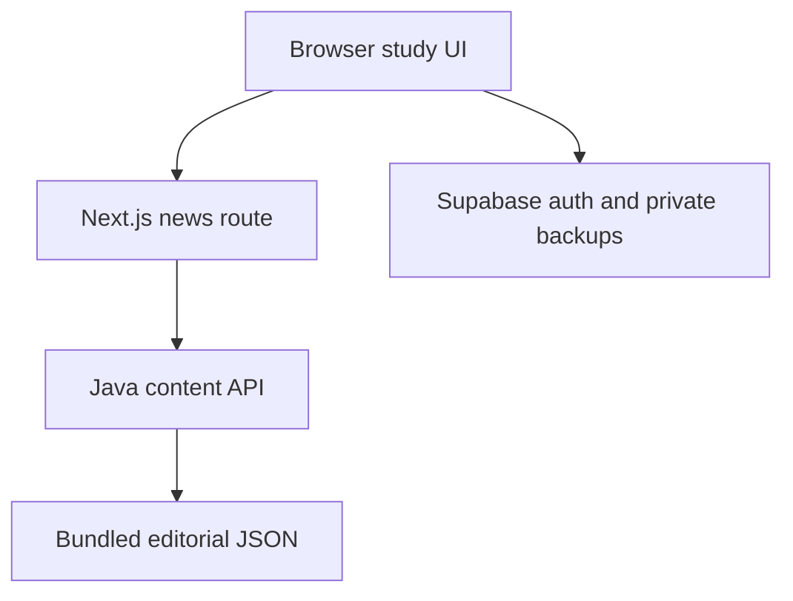

# Architecture

The browser calls the same-origin Next.js route. A server-only configured origin routes news to Spring Boot; credentials and private backups never enter the public Java API. The existing local archive path supports standalone frontend deployment. Java loads data once at startup, rejects unsafe publisher URLs, deduplicates IDs, sorts publication dates, and returns defensive copies. Content changes require a rebuild. No CORS exposure or write endpoint is needed for the public API.

Cloud backup authorization remains enforced by the existing Supabase RLS schema. Sign-in configuration and two-account isolation tests require provider access and are not claimed as verified by CI.
